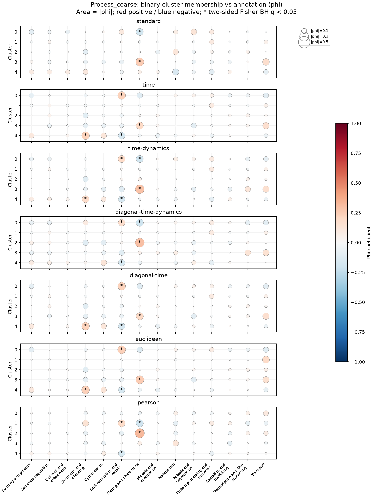
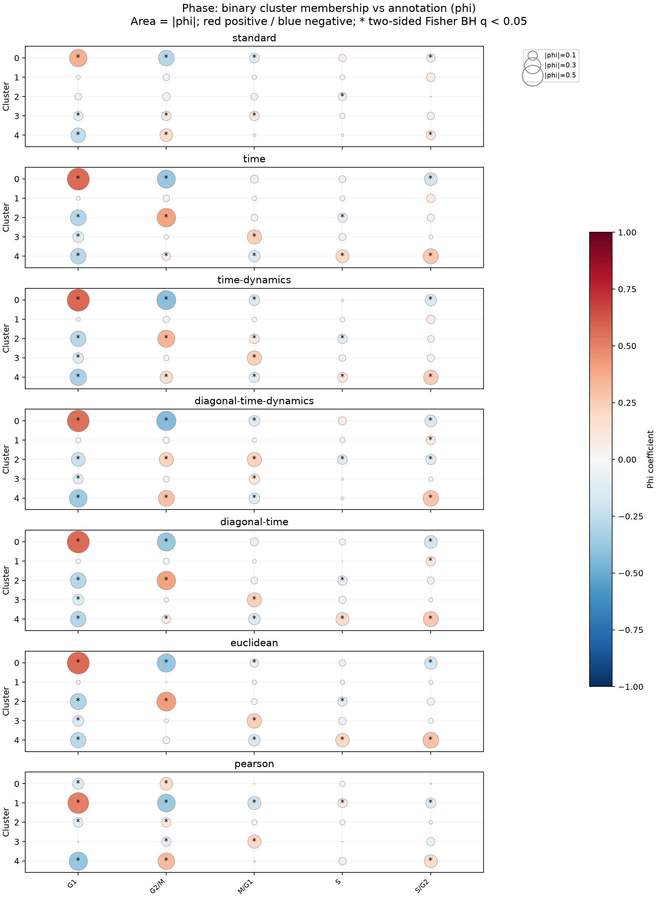
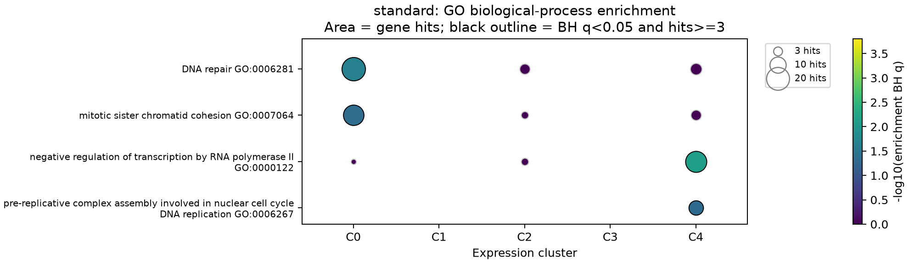
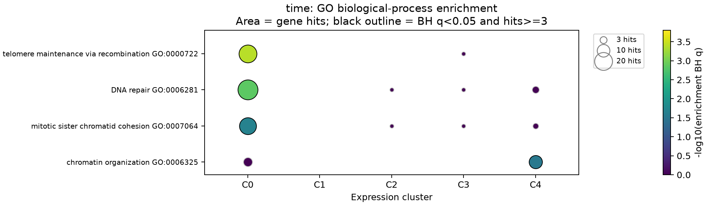
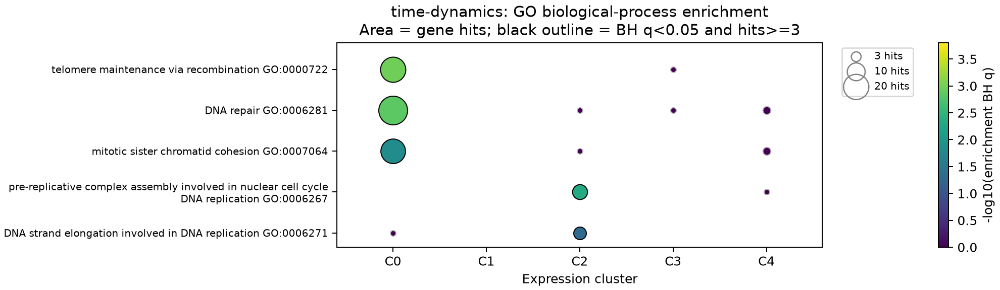
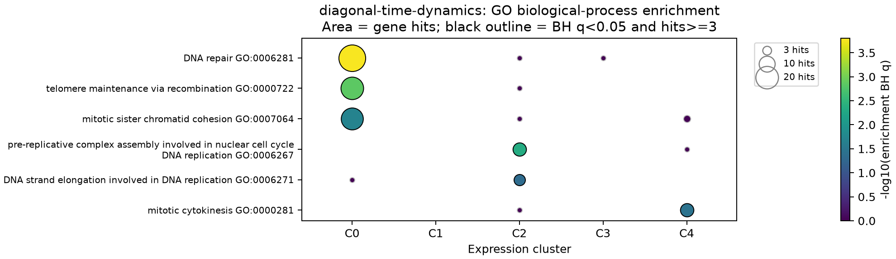
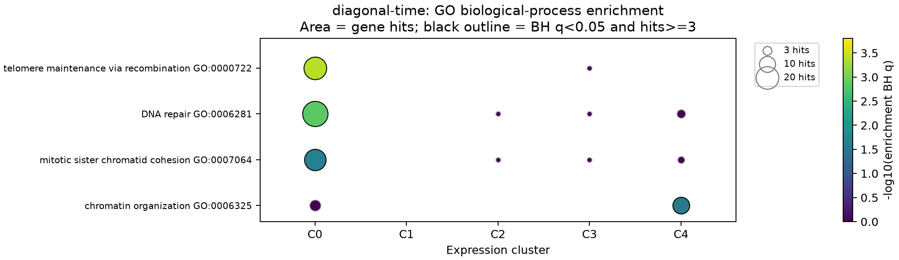
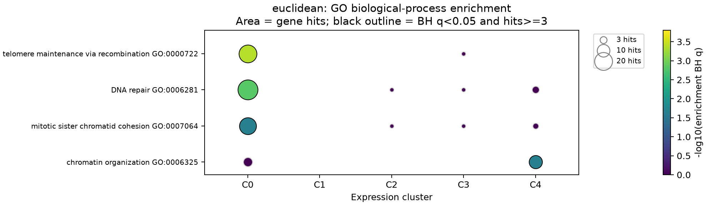
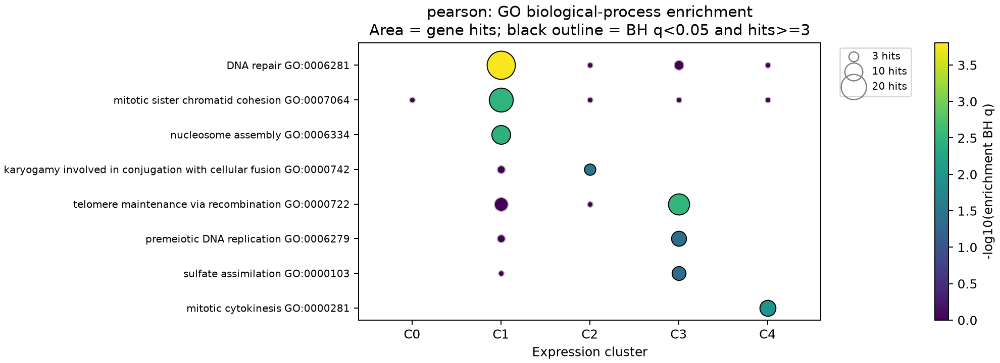
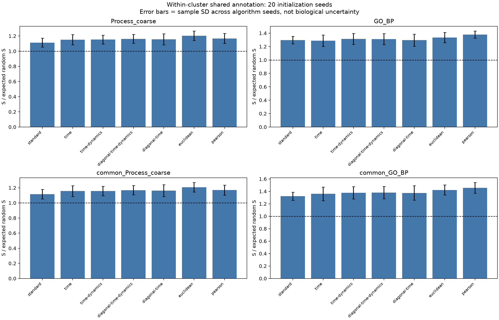

# Biological validation：表达簇与功能标签

日期：2026-11-27。所有新增过程、结果和图位于本目录。用户确认的气球图定义为：表达簇成员指示变量与功能标签指示变量的 φ 相关系数。另提供 GO 富集气泡图。

## 1. 数据、映射与研究范围

复用 2026-11-24 的 GSE3635 全部 6214 基因 × 13 时间点 centered.csv、七种距离矩阵、K=5、n_init=5、max_iter=100；不重新选择距离参数或 K。主展示用原 seed=42；稳定性增加 seed=42–61 共 20 个种子，每种方法用相同种子集合。
聚类只使用表达距离；Process、Function、phase、GO 均在聚类后连接。Numba 数组版保持 xqf 的初始 random.Random、求和顺序、并列处理及交替更新逻辑，并对原始源码小样本及七种全 6214 基因 seed42 结果作完全一致核对。

原始 Spellman 表解析得到 800 个唯一 ID；Process 已知 398、unknown 396、空白 6。空 ORF 的 YEL077C 依据一致的 YPD/SGD 名称及 orf800 恢复，没有直接删成799。

Process 保留原文和 Function，仅移除明确的 (putative) 并另保留 putative 标记；修正 metbolism/acod；按分号拆分，多标签保留。Function 只作为命中基因的解释文字。
自定义十四大类采用指引草案及明确关键词，术语到类别映射保存在 input/process_mapping.csv。其他、未分类不当作共同功能，也不用于检验；映射不依据簇的显著性调整。我们此前已看过表达簇/GO结果，因此本分析诚实标为探索性，不宣称独立盲法验证或事前注册。
“Transcription and RNA processing”包含原文 RNA 加工；分泌类包含 Golgi、内吞及液泡生物发生；允许多类，例如 DNA 损伤 checkpoint 同时可属于 DNA 修复和周期调控。这些是本项目归类，不是标准 GO 标签。

| 注释体系 | 实际可分析背景基因数 |
|---|---:|
| Process_coarse | 367 |
| Process_fine | 398 |
| Phase | 793 |
| GO_all | 740 |

其中 GO 为此前下载的 UniProt 2026_04 直接注释，仅覆盖 Spellman 名单；背景不包含未获得注释的其余表达基因。GO 不扩展祖先，不把 IEA 等计算证据称为实验证据。Process_coarse 排除没有任何可分类标签的记录；Process_fine 只要求原 Process 已知。

## 2. 统计定义与校正

每个簇×标签形成 [[a,b],[c,d]]，全部计数在对应可注释背景中：a=簇内有标签，b=簇内无标签，c=簇外有标签，d=簇外无标签。φ=(ad−bc)/sqrt((a+b)(c+d)(a+c)(b+d))，等于两个0/1变量的 Pearson 相关；正值为共同出现，负值为偏少。边际常数导致未定义时留空，不伪造0。
气球图面积=|φ|，颜色=φ，*表示双侧 Fisher 检验经 BH 校正 q_phi<0.05。它不是表达曲线 Pearson 相关图。相关方向是描述性关联，不解释为调控因果。
富集使用单侧 Fisher greater（等价超几何右尾），fold=(a/n)/(K/N)。先按背景基因频数≥5且非全背景筛选术语，所有零命中组合都参与BH；显著要求 q_enrichment<0.05、a≥3、fold>1。
每个注释体系分别将七方法×五簇×全部合格标签作为一个 BH 检验族；q_phi 与 q_enrichment 分开校正。不同体系为不同问题，不把其显著数量直接做优劣排名。
整体 S 为同簇基因对中至少共享一个标签的比例；它按基因对加权，因此大簇权重更高。背景内打乱簇标签保持簇大小不变，10000 次，p=(1+#(S_perm>=S))/(10001)。置换随机种子固定20261127。所有42个“场景×方法”置换p一起BH；它检验标签与当前簇的关联，不是实验生物学重复。
随机 S 的精确期望为背景内所有基因对共享标签的比例，与当前簇大小无关（只要有同簇对）。同时保存实际置换均值，并报告 S/该精确期望。20种子均值±样本SD只衡量算法初始化稳定性，不把20次当20份独立实验，不平均p值。
各簇的S仅作描述，不额外宣称逐簇置换显著。标签丰富度和类别粒度会影响S，因此另外在同一基因交集上比较 Process_coarse 和 GO_BP；即便如此，也不能把S数值当作统一的生物学准确率。

## 3. 主气球图





## 4. 富集结果

| 注释体系 | 检验数 | 显著簇×标签数 |
|---|---:|---:|
| Process_coarse | 490 | 17 |
| Process_fine | 525 | 11 |
| Phase | 175 | 42 |
| GO_all | 9625 | 110 |

下表列出每种方法最显著的自定义 Process 大类、以及最显著 GO 术语。所有逐簇表、命中基因和 Function 在 tables/ 中；未显著并不代表没有功能。

| 方法 | 最显著 Process 大类（簇、命中、fold、q） | 最显著 GO（簇、命中、fold、q） |
|---|---|---|
| standard | C3 Mating and pheromone; 7/25; fold=4.67; q=0.00933 | C4 negative regulation of transcription by RNA polymerase II; 17/291; fold=2.16; q=0.00747 |
| time | C0 DNA replication and repair; 35/155; fold=1.69; q=0.00075 | C0 telomere maintenance via recombination; 20/309; fold=2.28; q=0.000399 |
| time-dynamics | C3 Mating and pheromone; 11/44; fold=4.17; q=0.000705 | C0 telomere maintenance via recombination; 20/336; fold=2.10; q=0.00108 |
| diagonal-time-dynamics | C2 Mating and pheromone; 14/65; fold=3.59; q=0.000415 | C0 DNA repair; 28/345; fold=2.00; q=0.000172 |
| diagonal-time | C0 DNA replication and repair; 35/155; fold=1.69; q=0.00075 | C0 telomere maintenance via recombination; 20/310; fold=2.27; q=0.000399 |
| euclidean | C0 DNA replication and repair; 36/158; fold=1.71; q=0.000686 | C0 telomere maintenance via recombination; 20/313; fold=2.25; q=0.000414 |
| pearson | C2 Mating and pheromone; 9/27; fold=5.56; q=0.000686 | C1 DNA binding; 28/265; fold=2.30; q=0.000156 |

### standard 的 GO 生物过程



### time 的 GO 生物过程



### time-dynamics 的 GO 生物过程



### diagonal-time-dynamics 的 GO 生物过程



### diagonal-time 的 GO 生物过程



### euclidean 的 GO 生物过程



### pearson 的 GO 生物过程



## 5. 整体功能一致性与稳定性



| 场景 | 方法 | 背景N | seed42 S比值 | 置换q | 20种子比值均值±SD |
|---|---|---:|---:|---:|---:|
| Process_coarse | standard | 367 | 1.027 | 0.1739 | 1.113 ± 0.059 |
| Process_coarse | time | 367 | 1.177 | 0.0001615 | 1.151 ± 0.067 |
| Process_coarse | time-dynamics | 367 | 1.178 | 0.0001615 | 1.153 ± 0.059 |
| Process_coarse | diagonal-time-dynamics | 367 | 1.143 | 0.0008166 | 1.162 ± 0.058 |
| Process_coarse | diagonal-time | 367 | 1.177 | 0.0001615 | 1.156 ± 0.074 |
| Process_coarse | euclidean | 367 | 1.201 | 0.0001615 | 1.204 ± 0.062 |
| Process_coarse | pearson | 367 | 1.075 | 0.02207 | 1.168 ± 0.067 |
| Process_fine | standard | 398 | 1.143 | 0.004642 | 1.264 ± 0.086 |
| Process_fine | time | 398 | 1.228 | 0.0003706 | 1.252 ± 0.082 |
| Process_fine | time-dynamics | 398 | 1.201 | 0.001589 | 1.269 ± 0.067 |
| Process_fine | diagonal-time-dynamics | 398 | 1.246 | 0.00048 | 1.278 ± 0.068 |
| Process_fine | diagonal-time | 398 | 1.228 | 0.0003706 | 1.260 ± 0.082 |
| Process_fine | euclidean | 398 | 1.242 | 0.0003706 | 1.286 ± 0.067 |
| Process_fine | pearson | 398 | 1.283 | 0.0001615 | 1.315 ± 0.086 |
| Phase | standard | 793 | 1.232 | 0.0001615 | 1.263 ± 0.079 |
| Phase | time | 793 | 1.709 | 0.0001615 | 1.492 ± 0.155 |
| Phase | time-dynamics | 793 | 1.707 | 0.0001615 | 1.524 ± 0.136 |
| Phase | diagonal-time-dynamics | 793 | 1.691 | 0.0001615 | 1.526 ± 0.132 |
| Phase | diagonal-time | 793 | 1.702 | 0.0001615 | 1.504 ± 0.161 |
| Phase | euclidean | 793 | 1.716 | 0.0001615 | 1.568 ± 0.124 |
| Phase | pearson | 793 | 1.594 | 0.0001615 | 1.689 ± 0.141 |
| GO_BP | standard | 665 | 1.250 | 0.0001615 | 1.296 ± 0.057 |
| GO_BP | time | 665 | 1.352 | 0.0001615 | 1.288 ± 0.086 |
| GO_BP | time-dynamics | 665 | 1.303 | 0.0001615 | 1.314 ± 0.082 |
| GO_BP | diagonal-time-dynamics | 665 | 1.339 | 0.0001615 | 1.311 ± 0.082 |
| GO_BP | diagonal-time | 665 | 1.346 | 0.0001615 | 1.295 ± 0.090 |
| GO_BP | euclidean | 665 | 1.345 | 0.0001615 | 1.335 ± 0.078 |
| GO_BP | pearson | 665 | 1.430 | 0.0001615 | 1.378 ± 0.054 |
| common_Process_coarse | standard | 362 | 1.028 | 0.1697 | 1.116 ± 0.063 |
| common_Process_coarse | time | 362 | 1.176 | 0.00028 | 1.156 ± 0.071 |
| common_Process_coarse | time-dynamics | 362 | 1.179 | 0.00028 | 1.158 ± 0.063 |
| common_Process_coarse | diagonal-time-dynamics | 362 | 1.153 | 0.0003706 | 1.168 ± 0.061 |
| common_Process_coarse | diagonal-time | 362 | 1.176 | 0.00028 | 1.162 ± 0.078 |
| common_Process_coarse | euclidean | 362 | 1.200 | 0.00028 | 1.207 ± 0.062 |
| common_Process_coarse | pearson | 362 | 1.074 | 0.0273 | 1.169 ± 0.066 |
| common_GO_BP | standard | 362 | 1.255 | 0.0001615 | 1.322 ± 0.065 |
| common_GO_BP | time | 362 | 1.431 | 0.0001615 | 1.359 ± 0.111 |
| common_GO_BP | time-dynamics | 362 | 1.388 | 0.0001615 | 1.377 ± 0.098 |
| common_GO_BP | diagonal-time-dynamics | 362 | 1.424 | 0.0001615 | 1.380 ± 0.100 |
| common_GO_BP | diagonal-time | 362 | 1.431 | 0.0001615 | 1.374 ± 0.116 |
| common_GO_BP | euclidean | 362 | 1.411 | 0.0001615 | 1.422 ± 0.082 |
| common_GO_BP | pearson | 362 | 1.513 | 0.0001615 | 1.456 ± 0.087 |

## 6. GO 是否更好

GO 注释覆盖更广、ID与术语标准化、可保留证据来源，适合作为主要功能解释；Process 大类更简洁，适合作为直观可视化和补充核查。但不能因为GO检验更多或显著项更多就认定更好。
公平比较见 common_Process_coarse 与 common_GO_BP，它们具有完全相同的基因背景；仍需注意自定义大类与 GO 多标签的粒度不同。应该综合覆盖率、标签可靠性、对随机初始化的稳定性及命中基因解释判断，不用任何一项替代模拟ARI/NMI。
本次相同背景交集为362个基因。以预先保留的seed42标准DTW为例，Process大类 S比值约1.028、置换BH q约0.170，未达阈值；GO_BP S比值约1.255、q约0.000162。此例说明GO能提供这套粗分类未显示的关联支持，不证明GO是真值，也不代表标准DTW在所有种子下都无功能一致性，20种子的分布应一起看。
基于740个可注释基因的覆盖、可追溯标准术语和同背景对照，建议GO作为主要功能解释，Process大类气球图作为简洁补充；phase及周期名单验证单独保留。不同注释体系给方法的相对排序不完全相同，不能选择最有利的标签体系宣布某方法最优。
前次2026-11-24 GO结果采用最低背景频数3，本次按指引统一采用5，因此GO显著数量可能变化，不能据差异断言结果冲突。

## 7. 对老师 biological validation 要求的补充

tables/Spellman_membership.csv 对全部6214输入基因、其中793个Spellman命中做周期基因富集，跨35项BH。Phase气球图和Phase富集使用有阶段注释的匹配基因背景。它们分别回答“是不是周期基因”和“哪一阶段偏多”，功能/GO回答“做什么”。三部分共同提供支持，模拟benchmark仍须独立报告。

## 8. 复现

在当前目录执行：

```powershell
python -B run_seeds.py
python -B analyze.py
python -B verify.py
```

依赖 NumPy、SciPy、Numba、Matplotlib。所有源输入、距离矩阵和原组员代码只读；源文件与输出校验和、配置、检验核对、文件保护记录见 configuration.json、verification.json。20种子结果在 seed_runs/；10000次置换原始数组在 permutations/。
Process、GO和phase属于外部支持标签；历史注释不完整、基因间相关、GO层级依赖、固定K、无生物学重复等限制仍然存在。未知不代表阴性，关联不等于因果，初始化SD不代表生物学不确定性。

参考：Spellman et al. (1998), https://doi.org/10.1091/mbc.9.12.3273；GO 背景选择 https://geneontology.org/docs/go-enrichment-analysis/；置换p值加一原则 https://docs.scipy.org/doc/scipy/reference/generated/scipy.stats.permutation_test.html
