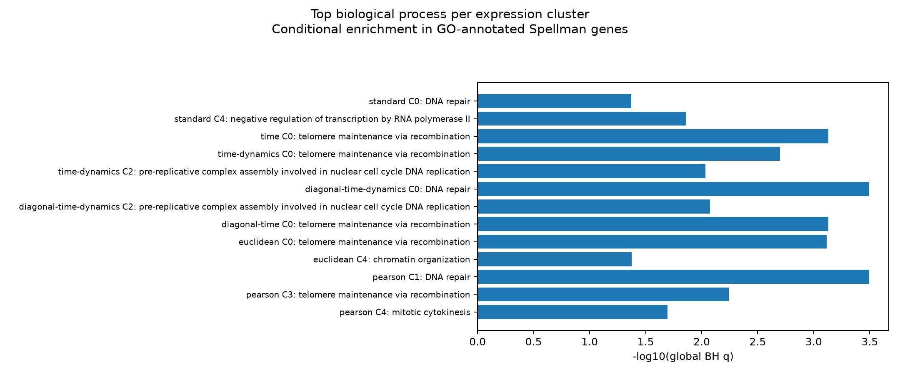
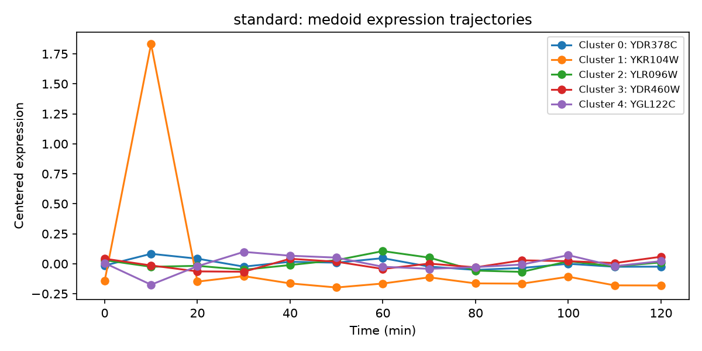
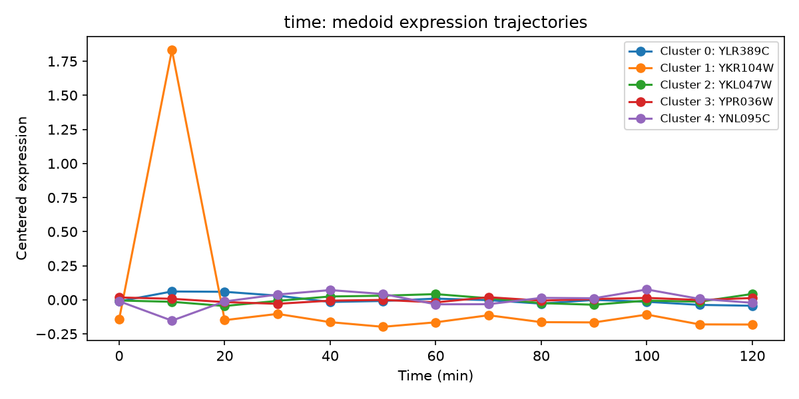
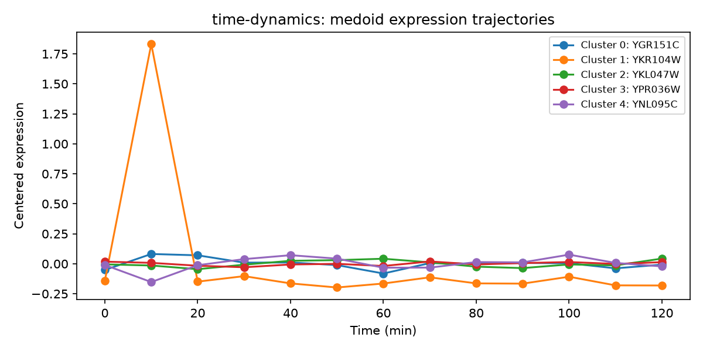
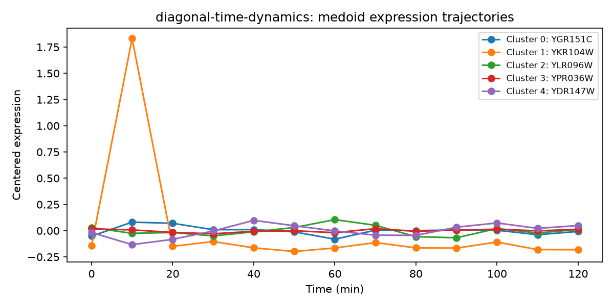
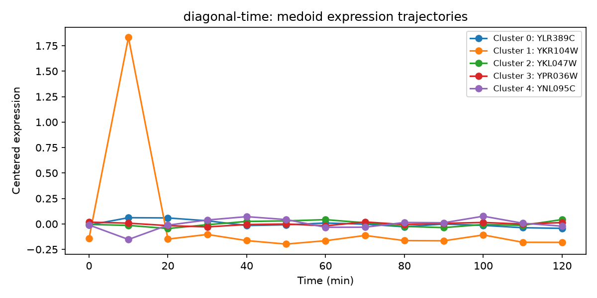
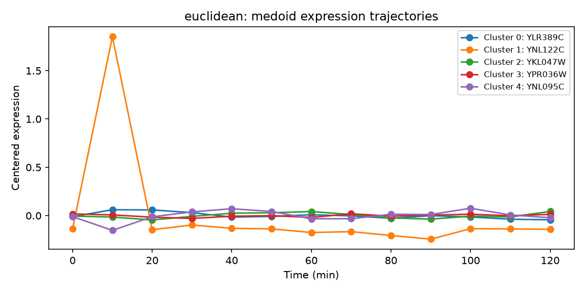
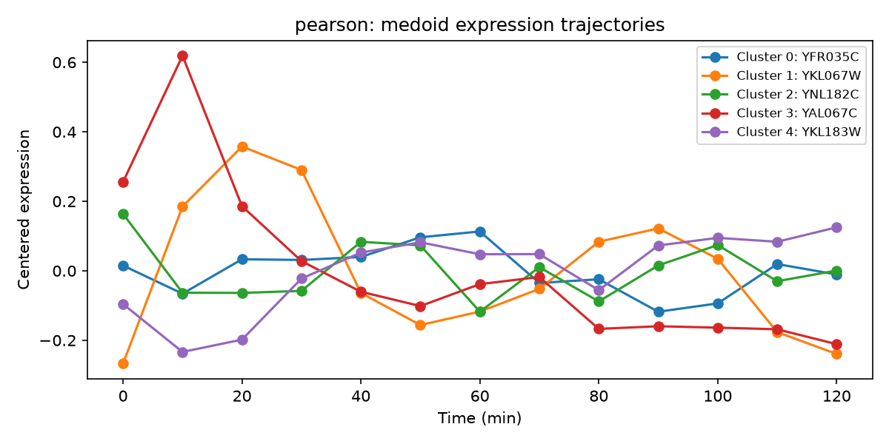

# GSE3635 表达轨迹聚类与 GO 富集分析

分析日期：2026-11-24。所有新增内容均位于本报告所在目录；其他组员文件仅只读。

## 1. 代码核查结论

**是按表达轨迹聚类。** zrz/dtw/dtw.py 读取 gene_id 和全部时间点表达值，逐基因对计算端点到端点的全局 DTW；局部代价为表达平方差，部分模式再加时间差、变化速率和拉伸惩罚。没有取峰值时间作为聚类特征，没有读取 GO 或 Spellman phase。DTW 本身只输出距离矩阵，不执行聚类。
xqf/xqf_clustering/k_medoids.py 对距离矩阵执行多起点交替 k-medoids：分配到最近 medoid，再选簇内总距离最小的基因。输入若为 DTW 表达距离，则输出是轨迹相似性分组。cluster_analysis.py 的 compare_k 用 silhouette 比较 K，其他函数绘图。
**注意文件差异：** xqf/clustering（无 .py 后缀）的 assign_clusters 中 labels[gene] = closest 缩进在外层循环外，可能遗留 -1 标签；本次使用 benchmark.py 指向的 xqf/xqf_clustering/k_medoids.py，该 .py 文件缩进正确，不使用有问题的无后缀副本。

## 2. 三个 Python 文件分别做什么

| 文件 | 实际工作 | 与 GO 的关系 |
|---|---|---|
| metrics.py | 不依赖第三方库实现 Hubert–Arabie ARI 与算术平均熵 NMI，按列联计数比较已有真标签和预测标签；不是聚类算法。 | 不读取 GO。 |
| benchmark.py | 冻结并校验 zrz 三种距离源码和 xqf k-medoids；读取 wpj 模拟 centered.csv；运行五种 DTW、Euclidean、Pearson；phase6 使用 true_cluster/K=6，shape5 使用 shape_cluster/K=5；缓存距离和预测；聚类后连接真值计算 ARI/NMI，保存预测、列联表、环境、来源校验和。 | 只处理 smoke/baseline/challenge/sweep 模拟组，不自动运行真实数据或 GO 富集。 |
| summarize_results.py | 汇总 results.csv 中每条件五个独立数据 seed 3100–3104 的 ARI/NMI 和耗时均值、样本 SD；相对 standard 计算配对差值与胜/平/负；输出 280 个条件汇总、配对表、baseline 表、六组 PNG/SVG 图和结果解读。 | 不重新聚类，不处理 GO。SD 不是置信区间。 |

完整 sweep 为 100 份数据 × 7 方法 × 2 任务 = 1400 行；默认再加 baseline 的 14 行。benchmark 默认 --team-root 指向旧目录，小组在当前目录重跑时应显式指定 --team-root D:\BMI\project11\lzy。该说明不代表本次运行了模拟 benchmark。
metrics.py 另进行了 160 次与 scikit-learn 的 ARI/NMI 对照，最大误差约 4.65e-16，见 metrics_validation.json。
距离模式曾按模拟真标签 ARI 调参，所以距离超参数来源是模拟监督选择；本次真实数据的分簇和 GO 分析没有读取真实 phase 标签来调参。

## 3. 本次真实数据分簇

未发现这套 zrz/xqf 代码生成的真实样本分簇文件，因此本次新运行；没有把旧 E 实现的 assignments 冒充组员代码结果。
输入为 wpj/predata/数据准备/outputs/real/GSE3635/run01/processed/centered.csv，全部 6214 基因 × 13 时间点；直接使用已居中表达值，保留幅度差异，不再 z-score，不仅限于 800 基因。该预处理与旧 E 的 6136 基因/质量屏蔽/z-score 分析不同，结果不可直接混同。
统一 K=5、seed=42、n_init=5、max_iter=100。K=5 是在 GO 分析前固定的比较设置（对应 xqf 绘图参考值），不是从本次数据估计的最优 K，更不是先验断言五个真实阶段。未用 GO 分数或 phase 选择模式、K 或种子。
为支持 6214 基因的全矩阵，用 Numba 执行与原始三状态 DTW 相同的数组递推（以数组复用替代逐对反复创建列表，并预计算相同时间坐标及局部速率），逐对对照原始函数验证；同时编译 k-medoids 的两个计算辅助函数。主 k_medoids 和 Python random.Random 保持原逻辑，源文件没有修改。原函数 JIT 另以等价二分替代不支持的 bisect 作对照。Euclidean/Pearson 使用向量计算，并与原始函数核对。精度核查见 acceleration_validation.json；此加速耗时不能冒充原纯 Python benchmark 耗时。

| 方法 | C0 | C1 | C2 | C3 | C4 |
|---|---:|---:|---:|---:|---:|
| standard | 2271 | 143 | 1167 | 1474 | 1159 |
| time | 1699 | 140 | 1464 | 2045 | 866 |
| time-dynamics | 1579 | 140 | 1501 | 2070 | 924 |
| diagonal-time-dynamics | 1655 | 132 | 911 | 2482 | 1034 |
| diagonal-time | 1701 | 128 | 1469 | 2046 | 870 |
| euclidean | 1729 | 89 | 1481 | 2069 | 846 |
| pearson | 835 | 1210 | 1229 | 1239 | 1701 |

## 4. GO 数据范围与统计方法

使用此前下载的 UniProt 2026_04 GO_long.csv，原始注释对象仅为 Spellman 800 名单。6214 个聚类基因中有 793 个属于该名单，其中 740 个有可用 GO。其他基因不视作 GO 阴性。
**本次回答的是：在有 GO 注释、且进入表达聚类的 Spellman 基因中，每个簇相对该参考子集富集哪些功能。不能据此声称已对全部 6214 个基因完成全背景功能验证。** 如需全体聚类基因背景，必须先为全部输入基因按统一规则获取 GO，再另立分析。
按 gene_id 与 GO_code 去重，一个基因的同一 GO 只计一次。保留 BP/MF/CC 及所有原始证据类型，包括 IEA；不将它们全称为实验证据。只使用 UniProt 返回的直接注释，不扩展祖先；根术语排除。基因是统计单位，不按长表行数计数。
背景 N=740；预先仅检验背景命中至少 3 基因的 510 个术语。所有方法与簇使用同一术语集合，零命中也保留为检验；总计 17850 项。
对每个簇与 GO，a=簇内有该 GO，b=簇内无该 GO，c=簇外有该 GO，d=簇外无该 GO，均限于上述可注释背景。单侧 Fisher exact（greater）检验富集，向量化计算用等价超几何右尾，并抽样对照 scipy fisher_exact。
主结论使用跨 7 方法 × 5 簇 × 所有术语的全局 BH 校正 q_global<0.05，且 fold_enrichment>1。另提供各方法内 BH q_within_method，不能与主阈值混用。GO 术语存在层级与统计依赖，结果作探索性生物学支持，不等于聚类准确率；不因显著数更多就认定某方法最优。
GO 官方建议自定义背景为实际可能进入所测集合的基因：https://geneontology.org/docs/go-enrichment-analysis/

## 5. 逐簇结果（主分析）

下表每簇报告最显著术语；“簇大小”为全表达簇，“GO基因”为实际用于富集的参考子集。完整 BP/MF/CC 结果、四格计数与命中基因见 enrichment/<method>/cluster_*.csv。不同方法相同编号不是相同生物学簇。

| 方法 | 簇 | 簇大小 | GO基因 | 显著GO数 | 最显著 GO | 命中/GO基因 | Fold | 全局q |
|---|---:|---:|---:|---:|---|---:|---:|---:|
| standard | 0 | 2271 | 269 | 1 | GO:0006281 DNA repair | 21/269 | 1.93 | 0.0426 |
| standard | 1 | 143 | 12 | 0 | 无全局显著富集 | — | — | — |
| standard | 2 | 1167 | 105 | 0 | 无全局显著富集 | — | — | — |
| standard | 3 | 1474 | 63 | 0 | 无全局显著富集 | — | — | — |
| standard | 4 | 1159 | 291 | 1 | GO:0000122 negative regulation of transcription by RNA polymerase II | 17/291 | 2.16 | 0.0139 |
| time | 0 | 1699 | 309 | 7 | GO:0000722 telomere maintenance via recombination | 20/309 | 2.28 | 0.000739 |
| time | 1 | 140 | 12 | 0 | 无全局显著富集 | — | — | — |
| time | 2 | 1464 | 118 | 0 | 无全局显著富集 | — | — | — |
| time | 3 | 2045 | 117 | 0 | 无全局显著富集 | — | — | — |
| time | 4 | 866 | 184 | 4 | GO:0030527 structural constituent of chromatin | 10/184 | 4.02 | 0.00134 |
| time-dynamics | 0 | 1579 | 336 | 4 | GO:0000722 telomere maintenance via recombination | 20/336 | 2.10 | 0.002 |
| time-dynamics | 1 | 140 | 12 | 0 | 无全局显著富集 | — | — | — |
| time-dynamics | 2 | 1501 | 121 | 3 | GO:0042555 MCM complex | 6/121 | 6.12 | 0.00903 |
| time-dynamics | 3 | 2070 | 92 | 0 | 无全局显著富集 | — | — | — |
| time-dynamics | 4 | 924 | 179 | 1 | GO:0046982 protein heterodimerization activity | 8/179 | 3.67 | 0.0281 |
| diagonal-time-dynamics | 0 | 1655 | 345 | 5 | GO:0006281 DNA repair | 28/345 | 2.00 | 0.00032 |
| diagonal-time-dynamics | 1 | 132 | 11 | 0 | 无全局显著富集 | — | — | — |
| diagonal-time-dynamics | 2 | 911 | 118 | 5 | GO:0042555 MCM complex | 6/118 | 6.27 | 0.00845 |
| diagonal-time-dynamics | 3 | 2482 | 85 | 0 | 无全局显著富集 | — | — | — |
| diagonal-time-dynamics | 4 | 1034 | 181 | 0 | 无全局显著富集 | — | — | — |
| diagonal-time | 0 | 1701 | 310 | 7 | GO:0000722 telomere maintenance via recombination | 20/310 | 2.27 | 0.000739 |
| diagonal-time | 1 | 128 | 10 | 0 | 无全局显著富集 | — | — | — |
| diagonal-time | 2 | 1469 | 119 | 0 | 无全局显著富集 | — | — | — |
| diagonal-time | 3 | 2046 | 117 | 0 | 无全局显著富集 | — | — | — |
| diagonal-time | 4 | 870 | 184 | 4 | GO:0030527 structural constituent of chromatin | 10/184 | 4.02 | 0.00134 |
| euclidean | 0 | 1729 | 313 | 7 | GO:0000722 telomere maintenance via recombination | 20/313 | 2.25 | 0.000768 |
| euclidean | 1 | 89 | 4 | 0 | 无全局显著富集 | — | — | — |
| euclidean | 2 | 1481 | 127 | 0 | 无全局显著富集 | — | — | — |
| euclidean | 3 | 2069 | 122 | 0 | 无全局显著富集 | — | — | — |
| euclidean | 4 | 846 | 174 | 4 | GO:0030527 structural constituent of chromatin | 10/174 | 4.25 | 0.000942 |
| pearson | 0 | 835 | 48 | 0 | 无全局显著富集 | — | — | — |
| pearson | 1 | 1210 | 265 | 8 | GO:0003677 DNA binding | 28/265 | 2.30 | 0.00029 |
| pearson | 2 | 1229 | 50 | 0 | 无全局显著富集 | — | — | — |
| pearson | 3 | 1239 | 160 | 5 | GO:0003676 nucleic acid binding | 17/160 | 3.42 | 0.00032 |
| pearson | 4 | 1701 | 217 | 3 | GO:0000142 cellular bud neck contractile ring | 8/217 | 3.41 | 0.0202 |

### 主要生物过程（BP）

**standard**

- C0：DNA repair (GO:0006281, 21/269, fold=1.93, q=0.0426)
- C1：没有达到全局 q<0.05 的 BP 术语。
- C2：没有达到全局 q<0.05 的 BP 术语。
- C3：没有达到全局 q<0.05 的 BP 术语。
- C4：negative regulation of transcription by RNA polymerase II (GO:0000122, 17/291, fold=2.16, q=0.0139)

**time**

- C0：telomere maintenance via recombination (GO:0000722, 20/309, fold=2.28, q=0.000739)；DNA repair (GO:0006281, 25/309, fold=2.00, q=0.00262)；mitotic sister chromatid cohesion (GO:0007064, 18/309, fold=1.96, q=0.0392)
- C1：没有达到全局 q<0.05 的 BP 术语。
- C2：没有达到全局 q<0.05 的 BP 术语。
- C3：没有达到全局 q<0.05 的 BP 术语。
- C4：没有达到全局 q<0.05 的 BP 术语。

**time-dynamics**

- C0：telomere maintenance via recombination (GO:0000722, 20/336, fold=2.10, q=0.002)；DNA repair (GO:0006281, 26/336, fold=1.91, q=0.00262)；mitotic sister chromatid cohesion (GO:0007064, 19/336, fold=1.90, q=0.0271)
- C1：没有达到全局 q<0.05 的 BP 术语。
- C2：pre-replicative complex assembly involved in nuclear cell cycle DNA replication (GO:0006267, 7/121, fold=5.35, q=0.00923)
- C3：没有达到全局 q<0.05 的 BP 术语。
- C4：没有达到全局 q<0.05 的 BP 术语。

**diagonal-time-dynamics**

- C0：DNA repair (GO:0006281, 28/345, fold=2.00, q=0.00032)；telomere maintenance via recombination (GO:0000722, 20/345, fold=2.04, q=0.00262)；mitotic sister chromatid cohesion (GO:0007064, 19/345, fold=1.85, q=0.0371)
- C1：没有达到全局 q<0.05 的 BP 术语。
- C2：pre-replicative complex assembly involved in nuclear cell cycle DNA replication (GO:0006267, 7/118, fold=5.49, q=0.00845)
- C3：没有达到全局 q<0.05 的 BP 术语。
- C4：没有达到全局 q<0.05 的 BP 术语。

**diagonal-time**

- C0：telomere maintenance via recombination (GO:0000722, 20/310, fold=2.27, q=0.000739)；DNA repair (GO:0006281, 25/310, fold=1.99, q=0.00265)；mitotic sister chromatid cohesion (GO:0007064, 18/310, fold=1.95, q=0.0405)
- C1：没有达到全局 q<0.05 的 BP 术语。
- C2：没有达到全局 q<0.05 的 BP 术语。
- C3：没有达到全局 q<0.05 的 BP 术语。
- C4：没有达到全局 q<0.05 的 BP 术语。

**euclidean**

- C0：telomere maintenance via recombination (GO:0000722, 20/313, fold=2.25, q=0.000768)；DNA repair (GO:0006281, 25/313, fold=1.97, q=0.00281)；mitotic sister chromatid cohesion (GO:0007064, 18/313, fold=1.93, q=0.0426)
- C1：没有达到全局 q<0.05 的 BP 术语。
- C2：没有达到全局 q<0.05 的 BP 术语。
- C3：没有达到全局 q<0.05 的 BP 术语。
- C4：chromatin organization (GO:0006325, 11/174, fold=2.92, q=0.042)

**pearson**

- C0：没有达到全局 q<0.05 的 BP 术语。
- C1：DNA repair (GO:0006281, 25/265, fold=2.33, q=0.00032)；mitotic sister chromatid cohesion (GO:0007064, 18/265, fold=2.28, q=0.00623)；nucleosome assembly (GO:0006334, 11/265, fold=2.79, q=0.00668)
- C2：没有达到全局 q<0.05 的 BP 术语。
- C3：telomere maintenance via recombination (GO:0000722, 14/160, fold=3.08, q=0.00572)
- C4：mitotic cytokinesis (GO:0000281, 8/217, fold=3.41, q=0.0202)

### 生物学解读

这些固定参数结果在部分表达簇中提供了 DNA 修复、端粒重组维护、染色质和细胞分裂相关功能支持；未达到阈值的簇不能解释为没有相关功能，部分簇可用 GO 基因数仅为个位数或十余个，统计功效有限。
time-dynamics 与 diagonal-time-dynamics 的 C2 均出现 MCM complex 与 DNA 复制前复合物组装相关注释，说明这些轨迹分组中有已知复制相关基因集中。但 GO 注释支持的是已知功能的一致性，不能从共簇推断调控方向、因果关系或恢复了真实细胞周期阶段。
主分析的部分染色质/核小体注释涉及共享蛋白条目的组蛋白基因；应结合下面的排除共享条目敏感性分析解释，不将重复证据误当作独立验证。具体显著数以保存的完整表为准，不用显著项数量给方法排名。

## 6. 共享 UniProt 条目的敏感性分析

先前 UniProt 审计显示 11 个历史基因共享 5 个蛋白条目，可能产生非独立注释。主分析保留原有精确基因映射，补充分析排除进入表达数据的全部共享基因；两者使用相同表达簇，不重新聚类。
排除名单：YBR009C, YBR010W, YCL012W, YCL014W, YJL018W, YJL019W, YML033W, YML034W, YNL030W, YNL031C。补充背景 N=730；相同全局 BH 原则下 44 个显著组合。补充分析重新构建可检验术语集，因此 q 值不宜逐数值直接比较。完整结果在 enrichment_no_shared/。

| 方法 | 主分析显著组合 | 排除共享后的显著组合 |
|---|---:|---:|
| standard | 2 | 1 |
| time | 11 | 5 |
| time-dynamics | 8 | 7 |
| diagonal-time-dynamics | 10 | 9 |
| diagonal-time | 11 | 5 |
| euclidean | 11 | 4 |
| pearson | 16 | 13 |

## 7. 复现与文件

依赖 Python、NumPy、SciPy、Numba、Matplotlib。执行 `python -B run_analysis.py`，已有真实分簇和距离缓存会复用，配置或源码变化会拒绝静默混用。全部结果、配置、源代码快照、原始输入快照都在此目录。
configuration.json 记录完整参数和组员源码 SHA256；enrichment/input_manifest.json 记录 GO 和 assignments 校验和；verification.json 包含精度、Fisher 等价、覆盖与其他组员文件未修改的检查。
主要文件：clustering/<method>/assignments.csv、medoids.csv、medoid_profiles.png、distance_matrix.npy；enrichment/all_tests.csv、significant.csv、cluster_coverage.csv、各簇 CSV；enrichment_no_shared/；source_snapshot/。
本次未运行根目录的模拟 benchmark.py/summarize_results.py，未修改这些文件的默认路径。

## 8. 解释边界与参考

结果为固定 K 与已选距离模式的一次真实数据探索；缺少生物学重复，GO 非完整真值，功能相似也不证明调控因果。同一参考集合的基因预选择、共表达依赖、注释覆盖和共享蛋白条目都影响解释。输入仅居中，幅度仍影响 DTW/Euclidean，Pearson 对幅度不敏感。
- Spellman PT et al. (1998), Molecular Biology of the Cell 9:3273–3297. https://doi.org/10.1091/mbc.9.12.3273
- GSE3635 真实数据：https://www.ncbi.nlm.nih.gov/geo/query/acc.cgi?acc=GSE3635
- UniProt 注释及原始 API 快照：../go_annotation/results/manifest.json。此次没有新联网下载 GO。
- GO 背景与富集解释：https://geneontology.org/docs/go-enrichment-analysis/
