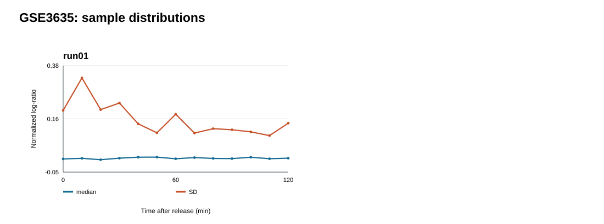
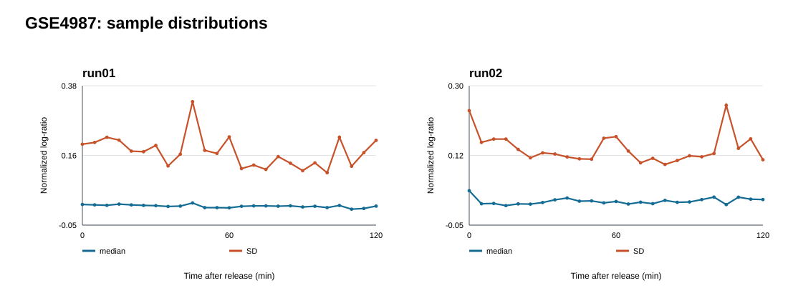
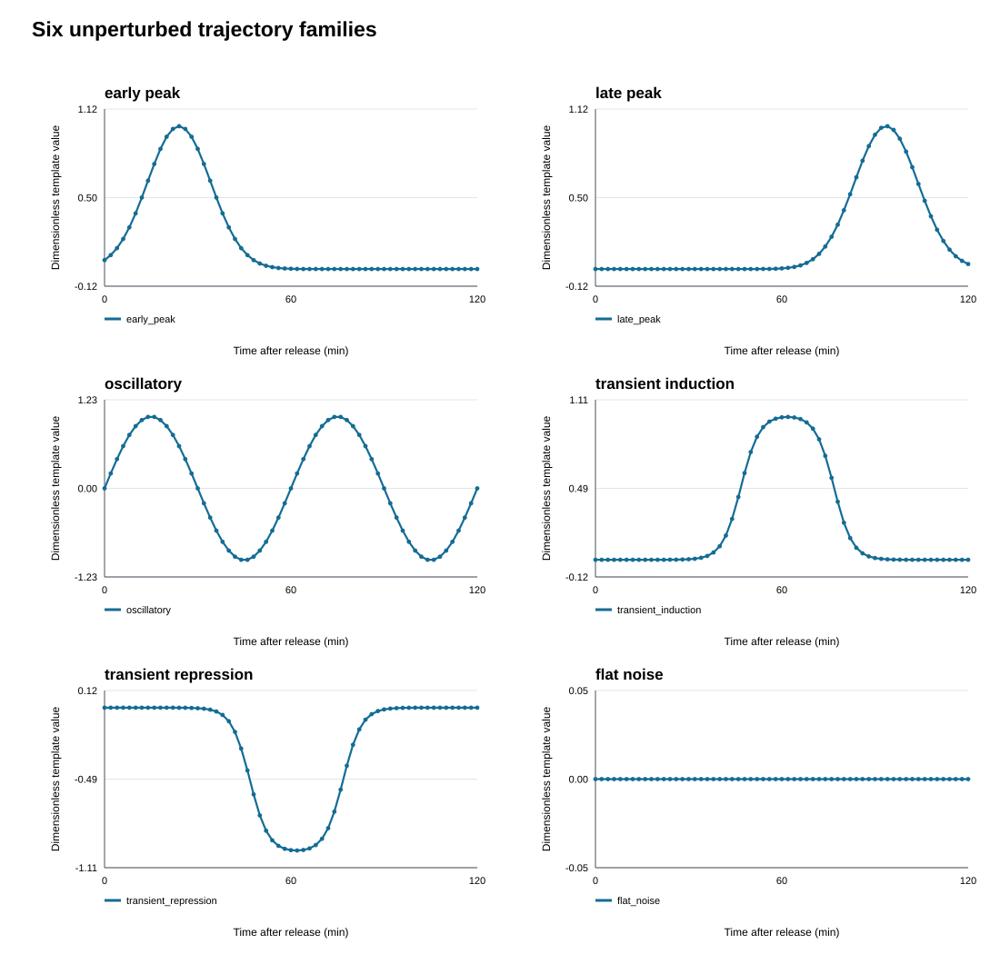
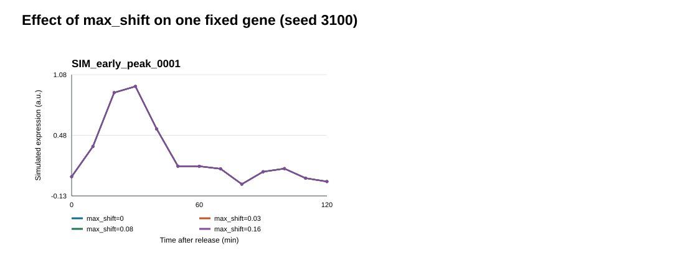
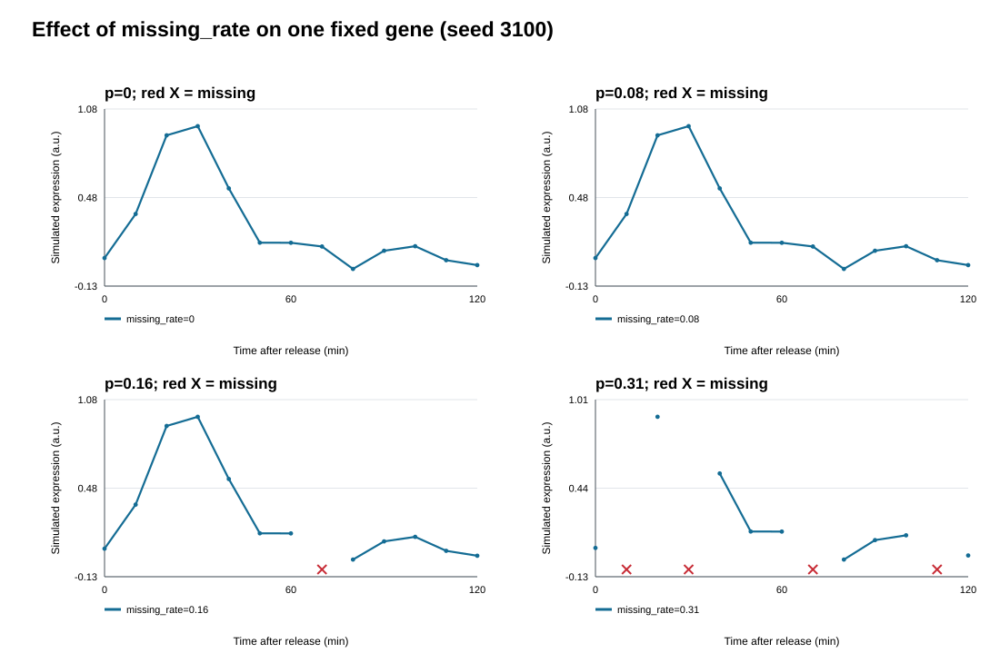

# Project 11：A 同学数据准备报告

**日期：2026-11-10｜用途：组内交接与 A 的方法记录**

## 1. 工作范围

本次完成了六类轨迹模拟、五因素受控数据、两份 GEO series matrix 的来源审查与转换、统一预处理、质量图和自动验收。老师对提案的主要疑问之一是“模拟数据怎么产生、扰动怎样用来 benchmark”；生成公式和实验设计已在 [simulation_design.md](../simulation_design.md) 逐项明确。本报告记录当前文件的实测结果。**尚无 DTW、聚类、ARI/NMI 或生物学验证结果。**

## 2. 真实数据审查

| 数据 | GEO 样本结构 | 矩阵尺寸 | 源空值 | ORF 筛选 | 预处理后 |
| --- | --- | ---: | ---: | ---: | ---: |
| GSE3635 | 一组 0–120 min，间隔 10 min | 6,228 × 13 | 172 / 80,964 | 6,215 行 | 6,214 行；165 值插补 |
| GSE4987 | 两组各 0–120 min，间隔 5 min | 6,228 × 50 | 440 / 311,400 | 6,215 行 | run01、run02 各 6,215 行；分别插补 352、87 值 |

两份矩阵都在 GPL1914 平台上。GEO 将 `VALUE` 描述为 Rosetta Resolver 的 normalized log ratio；它既不是 RNA-seq read counts，也不能未经批次/重复规则核对就与模拟数值或另一份研究直接合并。GSE3635 元数据说没有重复；GSE4987 说明有 dye-swap 技术重复。这里按样本标题中时间重置将 GSE4987 拆为两组，不预先平均。来源页面：[GSE3635](https://www.ncbi.nlm.nih.gov/geo/query/acc.cgi?acc=GSE3635)、[GSE4987](https://www.ncbi.nlm.nih.gov/geo/query/acc.cgi?acc=GSE4987)。

两份矩阵原本各有 6,228 个唯一 `ID_REF`。按明文 ORF 规则筛掉 13 个控制或非规范 ID，各剩 6,215 行。GSE3635 在 40% 缺失阈值下再剔除 1 行；其余缺失点被插补。GSE4987 两组均无额外删行。对应的来源文件 SHA-256、每个 GSM 的时间及分布、每个特征的保留理由、每个基因的删行/插补日志均在 `outputs/real/` 下。GSE3635 的 13 个归档 GPR 文件也已检查：每文件 7,056 条 spot 行，这不是 7,056 个独立基因，故聚类输入选用 GEO 已处理矩阵。





## 3. 模拟数据与受控实验

模拟器先给每条基因六类之一的 `true_cluster`，再生成峰、振荡、短暂上调/下调或平坦轨迹；之后加上可调幅度、相位位移、时间伸缩、测量噪声和随机缺失。表达矩阵与真标签分开保存。早峰/晚峰在主六类任务中分开，在次要 `shape_cluster` 五类任务中合并，以便讨论 DTW 对齐对生物学相位判断的影响。

已生成 `smoke`（12 条 × 7 点）、`baseline`（150 条 × 13 点）、`challenge`（150 条 × 13 点）及 100 套 sweep。`challenge` 共 629 个空值；预处理保留 122 行、插补 448 个值，另 28 行因缺失过多被剔除。sweep 的五因素为噪声、相位、幅度、缺失、伸缩，每因素四级、每级五个 seed；同一 seed 下稳定 gene ID 与独立随机流支持逐基因配对。







其余噪声、幅度和伸缩图也在 `figures/`。这些图只展示**输入轨迹如何变化**，不代表某算法恢复得好或差；D 须运行距离、聚类和评价后才能画性能图。

## 4. 预处理与下游接口

`preprocessing.py` 检查唯一 `gene_id`、严格递增的 `t数字` 时间列和有限数值；删除缺失比例大于 0.4 的行；在真实时间坐标上线性插补内部空值，用最近观测填补两端。每套数据均导出 `raw_imputed.csv`、`centered.csv` 和 `zscore.csv`，行顺序一致。主距离比较建议读取 `centered.csv`，因为它去掉任意基线而保留振幅。z-score 会消去振幅差异，只能作为单独敏感性分析。

B/C 可用 `outputs/simulated/smoke/processed/centered.csv` 先验证接口；D 通过 `sweep_index.csv` 定位每套同名矩阵，聚类**完成后**再按 `gene_id` 连接 `ground_truth.csv`。E 可读取 `outputs/real/GSE3635/run01/processed/centered.csv`，GSE4987 两组分别使用。真实数据没有模拟六类的真标签。

提交的 proposal 写了标准 DTW、三种单独惩罚变体及选定组合，并以 Euclidean/Pearson 作基线。老师要求进一步说清究竟测试几种方法、哪些是对文献思路的简化实现；B/D 在正式实验配置中需冻结这张方法表，并定义 proposal 中提到的 clustering accuracy。A 的数据格式对上述方法保持一致。

## 5. 复现与验收

在 `ICA/数据准备` 目录运行：

```bash
python3 build_all.py
python3 -m unittest discover -s tests -v
```

本次实跑的 7 项 unittest 全部通过，覆盖固定 seed 字节重现、不同 seed 变化、五因素确实改变观测、配对缺失、标签隔离、非等间隔插值、输入拒绝、两份 GEO 的行数及 100 套 sweep 的文件校验和。`README.md` 给出各模块的独立 CLI 和文件字段；`simulation_design.md` 给出六类公式、参数语义、真标签与预处理理由。

## 6. 局限与下一步

模拟器使用解析模板、独立高斯误差和随机缺失，不能完全代表真实微阵列的技术误差或基因间关联；强扰动可能使本来不同的类别变得难分。缺失阈值也会使不同条件保留的基因数不同，因此 D 报告 ARI/NMI 时必须同时报告纳入行数。GSE3635 缺乏生物学重复；GSE4987 的技术重复处理与跨研究可比性需要 E 再评估。组员应先固定主任务、预处理版本、k 与窗口调参方案，再运行正式 benchmark。

本目录代码和文字由生成式 AI 协助起草、实际运行及检查。课程正式提交时请团队成员复核并如实披露。
